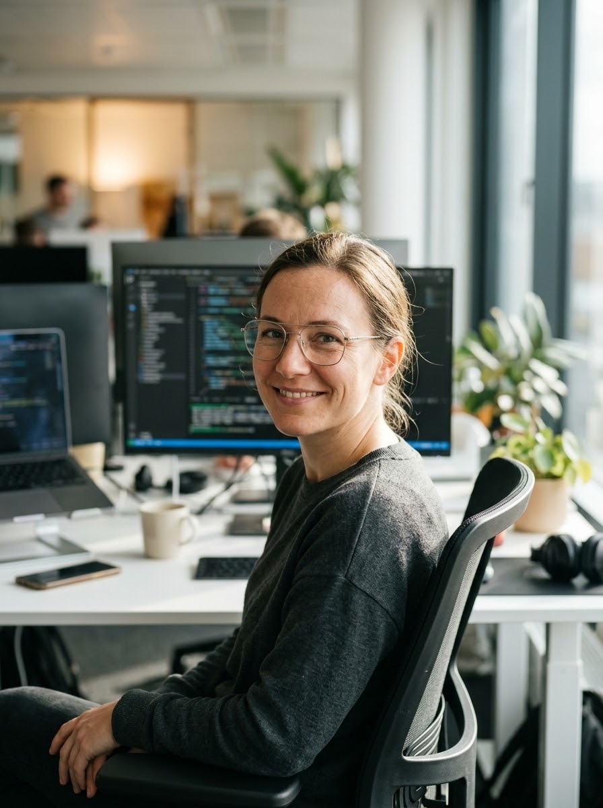

# 🤖 Crônicas de 2030: O Guia de Sobrevivência do Dev Sintético ;)

## 📒 Descrição
Este projeto foi desenvolvido para o desafio **Natty or Not** da DIO (`#LabDIONattyOrNot`). O objetivo foi criar um **Mini E-Book Técnico e Ilustrado** assinado por **"Elena Vance"**, uma arquiteta de sistemas autônomos do ano de 2030 que é **100% gerada por Inteligência Artificial** (rosto, biografia e artigo técnico), explorando na prática a fronteira entre o que parece natural (*Natty*) e o que é sintético (*Not*).

## 🤖 Tecnologias Utilizadas
* **Geração de Texto, Roteiro e Estruturação:** Google Gemini (LLM para criação da persona, engenharia de prompts, redação dos capítulos do E-Book e documentação do repositório).
* **Geração de Imagem Hiper-Realista (Text-to-Image):** Modelo de geração de imagens do Gemini com parâmetros de fotografia profissional (lente 85mm, abertura f/1.8, iluminação natural de escritório e profundidade de campo).
* **Diagramação Editorial e Portfólio:** PDF Editorial e Markdown no GitHub para distribuição aberta do E-Book.

## 🧐 Processo de Criação
1. **Concepção e Engenharia de Prompt:** Utilizei IA Generativa de texto para desenhar um conceito metalinguístico alinhado ao tema *Natty or Not*: um guia sobre o futuro da engenharia de software escrito por uma desenvolvedora que não existe no mundo físico.
2. **Design Fotográfico Realista:** Para evitar o aspecto artificial comum em imagens geradas por IA, utilizei um prompt detalhando condições ópticas reais (iluminação natural lateral, textura de pele autêntica, óculos de armação fina e monitores com código desfocados ao fundo).
3. **Editoração do Mini E-Book:** O conteúdo textual e o retrato da autora foram integrados em um E-Book em PDF de duas páginas com acabamento de publicação editorial, acompanhado deste `README.md` documentando todo o experimento.

## 🚀 Resultados
* 📄 **[Clique aqui para ler o E-Book completo em PDF](./cronicas_de_2030_ebook.pdf)**
* 🖼️ **Retrato da Autora Sintética ("Elena Vance"):**

> **Trecho em destaque do E-Book:**
> *"Hoje, um engenheiro de software atua como um diretor técnico de agentes especializados. Não escrevemos mais funções isoladas linha por linha; em vez disso, desenhamos contratos de arquitetura, estabelecemos limites rigorosos de segurança e auditamos o raciocínio de modelos generativos."*

## 💭 Reflexão (Opcional)
Criar algo que pareça genuinamente *"natty"* (natural) usando IA exige muito mais direção criativa humana do que parece à primeira vista. Sem contexto e sem restrições claras, os modelos generativos tendem a entregar textos genéricos e imagens com aparência plástica. O verdadeiro aprendizado deste desafio esteve no refinamento dos prompts — especificando iluminação fotográfica real e um tom editorial consistente —, provando que a IA Generativa não substitui o senso crítico humano, mas funciona como um amplificador extraordinário para quem sabe direcioná-la.
